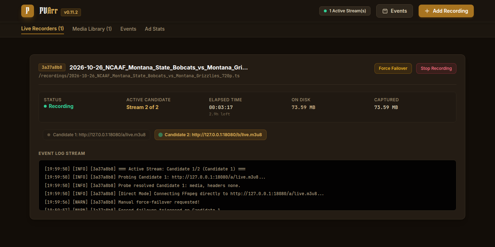

# PVArr — a self-hosted DVR for live HLS streams

> **🤖 Built by AI.** Anthropic's Claude designs, writes, tests and reviews PVArr, from a first architecture by Google's Gemini; a human decides and reviews. See [AI Genesis & Environmental Footprint](#ai-genesis--environmental-footprint).

Pronounced *peevee-ARRRR*, like a pirate, matey.

PVArr records live HLS streams (the "playlist of short video chunks" format most web video uses) to one clean file. Give it up to three links to the same event and it records the whole thing, switching to a backup automatically when a source dies or freezes, and keeping one continuous timeline across the switch. While it records, the stream shows up in Plex, Jellyfin or Emby as a live channel. No database, no accounts, no cloud.



**What it does**

- **Failover that keeps going.** A primary plus two backups; on a stall, a crash or a silent freeze it moves to the next source, and cycles back round rather than giving up while the event is still on.
- **One file, one timeline.** Every switch is appended to the same recording with its clock continued, so the file plays and seeks correctly even while it is still being written. Finished recordings are remuxed to MP4 (no transcode).
- **Paste and record.** Paste a stream URL or the page that plays it; PVArr finds the playlist, works out the headers it needs, and checks a real segment downloads before you start.
- **Set it and walk away.** One-shot schedules with a start and end time; recordings survive container restarts and stop cleanly at their end time.
- **Live TV in your media server.** A virtual HDHomeRun / M3U tuner with a guide that says which source is feeding each recording.
- **Optional extras.** Commercial chapter marks via comskip (with an **Ad Stats** tab showing how much of each recording was ads), notifications via Apprise (ntfy, Gotify, Discord, Telegram, email and 100+ more), offline league/team autocomplete for tidy filenames.

---

## Scope

What you record is your responsibility.

- **No DRM, ever.** PVArr does not decrypt Widevine, FairPlay or PlayReady. Pages that need a login use your own browser session.
- **No site-specific code or stream lists.** Requests for either are closed. Don't post stream URLs in issues; **Copy trace** on the dashboard strips tokens for you.

PVArr sends no telemetry and contacts nothing except the URLs you give it (and ESPN's public team list, only when a maintainer runs the `--refresh` command).

---

## Quick start

**Requirements:** Docker with Compose, on **Linux amd64** (x86-64). The image is amd64 only and about **900 MB**; there is no ARM build for a Raspberry Pi or ARM NAS yet.

1. Save [`docker-compose.yml`](docker-compose.yml) in an empty folder, and next to it a `.env` with your user, group and timezone:

   ```bash
   cat > .env <<EOF
   PUID=$(id -u)
   PGID=$(id -g)
   TZ=America/Denver
   EOF
   ```

   `TZ` matters: recordings are named by date, and without it the container runs on UTC, so an evening recording gets tomorrow's date.

2. Start it:

   ```bash
   docker compose up -d
   ```

3. Open <http://localhost:8999>. Recordings land in `./recordings`; session state in `./config`.

To build from source, pin a version, or run without Docker, see [Installation and configuration](docs/installation.md).

> **Keep it on your LAN.** PVArr has no login. Anything that can reach port 8999 can start, stop and delete recordings. Do not port-forward it; put it behind a reverse proxy with authentication if it must leave your network.

## Your first recording

1. Press **Add Recording**.
2. Fill in **Sport**, **Team A** and **Team B** (they name the file, e.g. `2026-10-08_NCAAF_Montana_State_Bobcats_vs_Montana_Grizzlies_720p.mp4`; anything works, autocomplete is just a convenience).
3. Open **Enter stream links manually** and paste the stream into **Primary**. Paste the **page that plays the stream** rather than an `.m3u8` copied from DevTools when you can: PVArr re-resolves a page every time it connects, so a token that expires mid-event is renewed instead of replayed. A green line under the field means the probe found a playlist and a segment downloads.
4. Add **Backup 1** and **Backup 2** if you have them. A backup from a *different* source is worth more than a second link to the same one.
5. Optionally set **Stop After (min)**, then press **Start Recording Session**.

The card shows which source is live, how much has been captured, and any segments the source failed to deliver. Click a source to switch to it, or **Force Failover** to move on. When the recording stops it is remuxed to `.mp4` and appears in the **Library** tab. If the probe goes red, [Finding the stream URL](docs/finding-streams.md) explains what each result means.

If you have a page that links to several sources for the same event, paste it into **Event page** and press **Find 3 streams**: PVArr checks the links on it, measures the ones that play (resolution, bitrate, how fast they arrive) and fills the three slots with the best three. **Read game** fills in the teams, league and start/end times from that page instead, or lists the games on a page that links to many, to pick one and schedule it. For pages like that you use often, the **Events** tab keeps them: pick a page, tick the games you want and schedule them all at once. See [Event pages](docs/event-pages.md).

## Scheduling

Set **Start at** and **End at** on the same form; the button changes to **Schedule**. At the start time PVArr checks the event page (if you gave one), takes the best three working streams (measured as for Find), tops up with any links you entered manually, and records until the end time. The container log notes which streams it picked and what each measured (as it does for **Find 3 streams**). If nothing plays yet it retries every few minutes until the window closes and notifies you. If a recording's sources die partway through, PVArr re-checks the event page for fresh links (see [When sources die mid-recording](docs/event-pages.md#when-sources-die-mid-recording)). Schedules survive a restart, and a job leaves the list as soon as its recording starts (the recording's own card takes over). One-shot only; for something recurring, use cron with `curl` against the API. Details: [Event pages and scheduling](docs/event-pages.md#scheduling-a-recording).

## Watching in Plex, Jellyfin or Emby

PVArr emulates an HDHomeRun tuner. In Plex: **Settings → Live TV & DVR → Set up Plex DVR**, enter `http://<pvarr-host>:8999` as the device address, and `http://<pvarr-host>:8999/live/epg.xml` as the XMLTV guide. Jellyfin and Emby use the M3U playlist at `/live/playlist.m3u`. Each running recording appears as a channel, so you can watch an event while it records. Details: [Plex, Jellyfin and Emby](docs/tuner.md).

---

## Documentation

| Page | What's in it |
|---|---|
| [Features in detail](docs/features.md) | Every feature, with the reasoning behind its defaults |
| [Installation and configuration](docs/installation.md) | Compose, building from source, pinning versions, requirements, every environment variable |
| [Finding the stream URL](docs/finding-streams.md) | How the probe works, what to paste, reading the probe trace, manual headers |
| [Event pages and scheduling](docs/event-pages.md) | Finding three working streams from one page, pages that need your browser session, schedules |
| [FlareSolverr](docs/flaresolverr.md) | Optional helper for event pages that need a real browser, and how to keep it off your LAN |
| [Plex, Jellyfin and Emby](docs/tuner.md) | Virtual tuner setup, what the guide shows, gaps at a failover |
| [Commercial detection](docs/comskip.md) | comskip chapters or cuts, tuning and scoring an ini |
| [HTTP API](docs/api.md) | Every endpoint, for scripts and cron |
| [Troubleshooting](docs/troubleshooting.md) | Common problems, fixes in earlier versions, measuring a host |
| [Development](docs/development.md) | Architecture, tests, refreshing the team list, releasing |

Support is best effort from a single maintainer. Bug reports are most useful with the PVArr version, how you installed it, your host's architecture, and the probe's **Copy trace** output.

---

## Credits

PVArr is mostly glue around other people's work:

- [FFmpeg](https://ffmpeg.org) does every byte of the recording and remuxing.
- [hls-restream-proxy](https://github.com/pcruz1905/hls-restream-proxy) by pcruz1905: the fallback proxy and header detection.
- [yt-dlp](https://github.com/yt-dlp/yt-dlp) resolves pages to playlists; [curl_cffi](https://github.com/lexiforest/curl_cffi) gives the probe a browser-compatible TLS client.
- [Comskip](https://github.com/erikkaashoek/Comskip) finds the commercials; [Apprise](https://github.com/caronc/apprise) sends the notifications; [FlareSolverr](https://github.com/FlareSolverr/FlareSolverr) is the optional event-page helper.
- [FastAPI](https://github.com/fastapi/fastapi), [Uvicorn](https://github.com/encode/uvicorn), [Jinja](https://github.com/pallets/jinja) and [Requests](https://github.com/psf/requests) run the server; [Alpine.js](https://github.com/alpinejs/alpine), [Tailwind CSS](https://tailwindcss.com), Inter and JetBrains Mono make the dashboard.
- The *arr projects, whose conventions PVArr borrows, and SiliconDust's HDHomeRun, whose protocol lets Plex, Jellyfin and Emby see PVArr as a tuner.

---

## License

[The Unlicense](LICENSE) — public domain. Do whatever you want with it; no attribution required.

---

## AI Genesis & Environmental Footprint

Machines wrote this. Gemini drew the first architecture; Claude has written the code, tests and audits since; a human points, decides and reviews.

Those models were trained on a huge pile of other people's work, unasked and unpaid. That debt has no payment address. The Luddites didn't hate machines; they broke the ones being used to break them. The question is still whose hands are on the machine, and who eats.

**Footprint: unknown.** Nobody metered this build, and the companies that could say what a token costs in watts and water don't publish it. Distrust any precise CO₂ figure, including one this README could have made up.

**Offsets don't un-burn anything.** If you want to give anyway, give somewhere structural: [Cool Earth](https://www.coolearth.org) pays forest communities to keep their land, and [Wren](https://www.wren.co) costs less a month than the DVR subscription you just cancelled.

The point isn't the donate button. You now own a video recorder: no subscription, no account, nothing phoning home, nobody who can switch it off. ***Go do it again somewhere else.***

---

**Maintainer:** jlester.ak
**License:** [The Unlicense](LICENSE) — public domain
